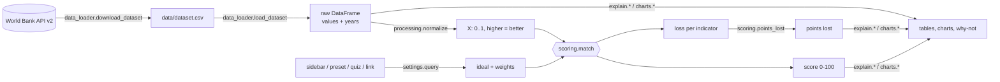

# Country Matcher — Complete Project Guide

This guide explains the whole project: what it does, how the data flows, the math behind
the ranking, and what every module and function does. Read it top to bottom once; later use
the table of contents as a reference.

1. [What the app does](#1-what-the-app-does)
2. [Running it](#2-running-it)
3. [The big picture](#3-the-big-picture)
4. [The core idea, with a worked example](#4-the-core-idea-with-a-worked-example)
5. [The data](#5-the-data)
6. [Module reference (every function)](#6-module-reference-every-function)
7. [What happens on one page load](#7-what-happens-on-one-page-load)
8. [Session state: every key](#8-session-state-every-key)
9. [Shareable links](#9-shareable-links)
10. [The preference quiz](#10-the-preference-quiz)
11. [Translations (i18n)](#11-translations-i18n)
12. [Tests](#12-tests)
13. [Design decisions and pitfalls](#13-design-decisions-and-pitfalls)
14. [How to extend the project](#14-how-to-extend-the-project)
15. [Glossary](#15-glossary)

---

## 1. What the app does

Country Matcher is a Streamlit web app that ranks ~195 countries by how close they are to the
profile a user wants. It uses 10 World Bank indicators (homicides, GDP, life expectancy, air
pollution, corruption…) grouped into 6 categories (safety, economy, health, environment,
governance, digital).

The user tells the app what matters (weights) and, optionally, what level they want (ideal).
The app gives every country a score from 0 to 100 and explains it: which areas cost a country
points, why the leader beats a chosen country, what the real numbers are and how old they are.

Ways to tell the app what you want:

| Way | What it sets |
|---|---|
| Sliders in the sidebar | 6 category weights (0–10), per-indicator multipliers (0–2) |
| **Mode** "Best overall" | ideal = 1.0 everywhere (the best possible country) |
| **Mode** "My ideal" | ideal from "desired level" sliders (e.g. economy 0.6 = not the richest) |
| **Mode** "Similar to a country" | ideal = that country's own profile, equal weights |
| 12 presets (Student, Retiree…) | weights + ideal in one click |
| Preference quiz | 7 everyday situations, each skippable → weights, multipliers and ideal calculated for you |
| Shared link | everything above restored from the URL |

Other features: 15 UI languages (uk, en, de, fr, zh, es, it, pt, pl, nl, cs, tr, ja, ko, hi), light/dark charts, region filter,
"complete data only" filter, CSV export, a country profile tab, a "how fresh is the data" line,
a public link through ngrok.

---

## 2. Running it

```bash
python -m venv .venv
.venv\Scripts\activate              # macOS/Linux: source .venv/bin/activate
pip install -r requirements.txt
streamlit run app.py                # http://localhost:8501
pytest                              # 194 tests
python data_loader.py               # download fresh World Bank data (~15 s)
python .ngrok/start.py              # app + public internet link (see 6.12)
```

The app runs **offline** from `data/dataset.csv`. The network is used only when someone presses
"Refresh World Bank data" (only visible on your own machine) or runs the ngrok launcher.

---

## 3. The big picture



One function, `scoring.match()`, powers every mode. Everything before it prepares inputs;
everything after it explains outputs.

Module layout (one module per concern, all at the project root):

| File | Responsibility | Depends on |
|---|---|---|
| `config.py` | ids and meaning of indicators, categories, modes | nothing |
| `data_loader.py` | download from World Bank, cache to CSV, load | config |
| `processing.py` | normalize raw values to 0..1 | config |
| `scoring.py` | weights, distance, score, loss breakdowns | config |
| `presets.py` | 12 ready-made profiles (data only) | nothing |
| `i18n.py` + `locales/*.json` | every human-readable text, 15 languages (one JSON file per language) | babel, pycountry |
| `settings.py` | user settings as plain dicts; presets; links | config, i18n, presets, scoring |
| `quiz.py` | preference quiz → settings | config, settings |
| `explain.py` | tables and explanations | config, i18n |
| `charts.py` | plotly figures (no Streamlit) | config, i18n |
| `app.py` | Streamlit UI only, no business logic | everything above |
| `.ngrok/start.py` | run app + public tunnel | ngrok SDK |

Rule of thumb: **only `app.py` imports Streamlit.** Everything else is plain Python/pandas and is
unit-tested directly.

---

## 4. The core idea, with a worked example

### 4.1 Countries are vectors

After normalization each country is a vector of 10 numbers between 0 and 1, where **1 is
always best** (for "lower is better" indicators like homicides the scale is flipped).

### 4.2 Score = closeness to the ideal

For a country `x`, an ideal `ideal` and weights `w` (all per indicator):

```
wsum   = Σ w_i                     (over indicators the country actually has)
loss_i = w_i · (x_i − ideal_i)² / wsum
dist   = √(Σ loss_i)               (weighted root-mean-square distance, 0..1)
score  = (1 − dist) · 100
```

* Missing indicator → skipped, and the remaining weights are renormalized via `wsum`.
* A country with no usable weight at all is dropped.
* All weights 0 → empty result (the app shows a "give some category a weight" message).

### 4.3 From category weights to indicator weights

The sidebar has 6 category sliders. `expand_weights()` splits each category weight evenly among
its indicators, so a category with 3 indicators doesn't count 3× more than a category with 1:

| Category | Indicators | Slider 5 → weight per indicator |
|---|---|---|
| safety | homicides, political stability | 2.5 each |
| economy | GDP, unemployment, inflation | 1.667 each |
| health | life expectancy, health spending | 2.5 each |
| environment | PM2.5 | 5 |
| governance | control of corruption | 5 |
| digital | internet users | 5 |

Then each indicator weight is multiplied by its "fine-tune" multiplier (0–2, default 1).

### 4.4 Worked example: Germany, default settings ("Best overall", all sliders 5)

Real numbers from the current `data/dataset.csv`:

| Indicator | Raw value | x (0..1) | w | loss | points lost |
|---|---|---|---|---|---|
| Intentional homicides /100k | 0.91 | 0.984 | 2.5 | 0.0000 | 0.02 |
| Political stability | 0.21 | **0.656** | 2.5 | **0.0099** | **8.27** |
| GDP per capita (PPP, $) | 75,407 | 0.958 | 1.667 | 0.0001 | 0.08 |
| Unemployment, % | 3.71 | 0.872 | 1.667 | 0.0009 | 0.76 |
| Inflation, % | 2.17 | 0.913 | 1.667 | 0.0004 | 0.35 |
| Life expectancy | 80.8 | 0.880 | 2.5 | 0.0012 | 1.01 |
| Health spending /capita, $ | 6,849 | 1.000 | 2.5 | 0.0000 | 0.00 |
| Air pollution PM2.5 | 8.81 | 0.928 | 5 | 0.0009 | 0.71 |
| Control of corruption | 1.68 | 0.954 | 5 | 0.0003 | 0.29 |
| Internet users, % | 93.5 | 0.945 | 5 | 0.0005 | 0.43 |

* `wsum = 30`, `Σ loss = 0.01425`, `dist = √0.01425 = 0.1194`, **score = 88.06** (rank 13 of 194).
* Points lost add up to exactly `100 − 88.06 = 11.94`. Two thirds of Germany's gap is
  **political stability** — that is what the "weakest areas" tooltip and the "Why not X?"
  charts surface.
* Top 5 with these settings: Iceland 95.1, Switzerland 94.5, Norway 94.5, Australia 93.2,
  Hong Kong 93.1.

### 4.5 Why "points lost" instead of raw loss

`loss` adds up to `dist²`, which is not on the score's scale. `points_lost()` rescales each
row so it adds up to `100 − score`:

```
points_lost_i = loss_i · 100 / √(Σ loss)
```

Because shares stay proportional to `loss`, the order of "what hurts most" is unchanged, but
now numbers are in score points: "political stability costs Germany 8.4 points". And the
difference between two countries' points lost adds up to their score difference, which is why
the "Why not X?" bars are exact. **All display uses points lost.**

---

## 5. The data

### 5.1 The 10 indicators (`config.INDICATORS`)

| Id (used everywhere) | World Bank v2 id | Category | Lower is better | Log scale |
|---|---|---|---|---|
| `WB_WDI_VC_IHR_PSRC_P5` | VC.IHR.PSRC.P5 | safety | yes | |
| `GOV_WGI_PV` | WB_WGI, estimate (db 3) | safety | | |
| `WB_WDI_NY_GDP_PCAP_PP_CD` | NY.GDP.PCAP.PP.CD | economy | | yes |
| `WB_WDI_SL_UEM_TOTL_ZS` | SL.UEM.TOTL.ZS | economy | yes | |
| `WB_WDI_FP_CPI_TOTL_ZG` | FP.CPI.TOTL.ZG | economy | yes | |
| `WB_WDI_SP_DYN_LE00_IN` | SP.DYN.LE00.IN | health | | |
| `WB_WDI_SH_XPD_CHEX_PC_CD` | SH.XPD.CHEX.PC.CD | health | | |
| `WB_WDI_EN_ATM_PM25_MC_M3` | EN.ATM.PM25.MC.M3 | environment | yes | |
| `GOV_WGI_CC` | WB_WGI, estimate (db 3) | governance | | |
| `WB_WDI_IT_NET_USER_ZS` | IT.NET.USER.ZS | digital | | |

The project ids are the real World Bank **Data360** ids, so `data_loader` requests them as they
are. The second column above says which Data360 database holds each one (see 13.1).
WDI = World Development Indicators (database 2), WGI = Worldwide Governance Indicators (database 3,
estimates roughly −2.5…+2.5).

### 5.2 `data/dataset.csv`

* Index `iso3` (e.g. `UKR`), then `country`, `region`, the 10 indicator columns, then 10 year
  columns `<id>_year` (year of the latest available value; empty if the value is missing).
* 217 economies; World Bank aggregates (World, Euro area, income groups…) are excluded.
* Years range from 2010 to 2025 (older values are dropped as stale). The "Actual values" table shows the year
  next to every number so users can see how fresh it is.
* `data/mock_dataset.csv`: 26 made-up rows with the same columns. Used by tests and as the
  fallback when `dataset.csv` doesn't exist. **Its values are fake.**

### 5.3 Normalization (`processing.normalize`)

Order matters; every step is per indicator column:

1. **Drop sparse countries**: more than `max_missing` (default 2) of 10 indicators missing → dropped.
   217 → 194 countries. "Only countries with complete data" uses `max_missing=0`.
2. **Log** for GDP (`log_scale=True`): $2k vs $4k matters more than $80k vs $82k.
3. **Winsorize** at the 5th/95th percentile: extreme outliers (hyperinflation, extreme homicide
   rates) are clipped so they don't squash everyone else into a tiny range.
4. **Min-max** to 0..1. A constant column becomes 0.5. Missing stays missing.
5. **Invert** lower-is-better indicators: `x → 1 − x`.

GDP example for Germany: log(75,407) = 11.231; among the 195 kept countries the 5th percentile
is log(2,097) = 7.648 and the 95th is log(88,393) = 11.390; so
`x = (11.231 − 7.648) / (11.390 − 7.648) = 0.958`.

Consequence: scores are **relative** to other countries in the dataset, not absolute.

---

## 6. Module reference (every function)

### 6.1 `config.py` — ids and meaning (no display text)

| Name | What it is |
|---|---|
| `Indicator(code, db, category, lower_is_better, log_scale=False)` | NamedTuple describing one indicator |
| `CATEGORIES` | `("safety", "economy", "health", "environment", "governance", "digital")` — order is used everywhere |
| `MODES` | `("best", "ideal", "similar")` |
| `INDICATORS` | the 10 indicators (table 5.1) |
| `INDICATOR_CODES` | list of the 10 ids, in order |
| `CATEGORY_OF` | `{indicator id: category}` |
| `LOWER_IS_BETTER` | ids to invert during normalization |
| `LOG_SCALED` | ids to log during normalization (GDP) |
| `YEAR_COLUMNS` | `{id: "<id>_year"}` |

Everything else derives from `INDICATORS`, so adding an indicator starts here (see 14.1).

### 6.2 `data_loader.py` — download, cache, load

| Function | How it works |
|---|---|
| `get_json(session, url, **params)` | One GET, 60 s timeout, parsed JSON; raises on HTTP errors. |
| `fetch_countries_metadata(session)` | v2 API `GET /country` (Data360 has no country list) → DataFrame `iso3 → country, region`. Rows whose region id is `"NA"` are aggregates (World, income groups…) and are skipped. Strips stray spaces. |
| `fetch_rows(session, params)` | Generator over every Data360 observation matching `params`, following its `skip` paging (1,000 rows per page). Raises if the answer isn't data (e.g. a firewall page). |
| `fetch_indicator(session, indicator, iso3s)` | One indicator from Data360: `DATABASE_ID` (db 2 → `WB_WDI`, db 3 → `WB_WGI`), only our countries (`REF_AREA`), only years ≥ `FIRST_YEAR` (2010), and for governance only the estimate (`COMP_BREAKDOWN_1=WGI_EST`; the API also publishes ranks and standard errors). Keeps "total" rows (`_T`/`_Z` breakdowns) and the latest year per country → `iso3 → value, year`. |
| `fetch_indicators(session, iso3s)` | Runs `fetch_indicator` for all 10 indicators, 4 at a time, side by side: 10 value columns + 10 year columns (nullable `Int64`). |
| `download_dataset()` | Countries joined with their indicators (`inner` join drops economies without any data). About 15 s. |
| `load_dataset(refresh=False)` | If `refresh`: download and overwrite `dataset.csv`. Then read `dataset.csv` (or the mock file if it doesn't exist). `keep_default_na=False` stops pandas from reading Namibia's code `NA` as missing. Year columns become `Int64` when present. |
| `summarize(df)` | `{countries, values, first, last}`: country count, known values and the year span (None without year columns). Used by the sidebar and the command line. |
| `main()` | `python data_loader.py`: refresh the data and print the summary. |

### 6.3 `processing.py` — normalization

| Function | How it works |
|---|---|
| `winsorize(X, lower=0.05, upper=0.95)` | `X.clip(quantile(lower), quantile(upper), axis=1)` — per column. |
| `min_max(X)` | `(X − min) / (max − min)`; constant columns → 0.5; NaN preserved via `.where(X.notna())`. |
| `normalize(df, max_missing=2)` | The 5 steps of 5.3. Returns `iso3 × 10` frame in 0..1, higher = better. |

### 6.4 `scoring.py` — the math

| Function | How it works |
|---|---|
| `expand_weights(cat_weights)` | `{category: weight}` → Series per indicator: category weight ÷ number of indicators in that category. Missing categories → 0. |
| `match(X, ideal, w)` | The core (section 4.2). Aligns `w` and `ideal` to X's columns; a dimension counts only if both country and ideal have a value; drops countries with `wsum == 0`; returns `(score, loss)` sorted best first. Missing dimensions get loss 0. |
| `similar_to(X, iso3)` | Mode 3: `match(X without iso3, ideal = X.loc[iso3], equal weights)`. |
| `loss_by_category(loss)` | Sums indicator columns into the 6 categories (works for loss or points lost). |
| `points_lost(loss)` | Rescales loss so each row sums to `100 − score` (section 4.5). |
| `category_levels(X)` | Mean of a category's normalized indicators × 100 → 0..100 level per category. Used by the Explore scatter. |

### 6.5 `presets.py` — ready-made profiles

`PRESETS = {id: {"weights": {6 categories: 0..10}, "ideal": {category: 0..1}}}`.
Ids: `student, remote, family, retiree, startup, it_specialist, eco, job_seeker, safety_first,
medical, integrity, balanced`. Display names live in `i18n` under `preset.<id>`.
A preset with a non-empty `ideal` switches to "My ideal" mode; `balanced` (empty ideal) uses
"Best overall".

### 6.6 `settings.py` — settings as plain data

"Settings" = a dict whose keys are exactly the `st.session_state` keys (section 8). Keeping them
as plain dicts makes presets, the quiz and links testable without Streamlit.

| Name | How it works |
|---|---|
| `DEFAULTS` | language uk, mode best, all weights 5, all ideals 1.0, all multipliers 1.0 |
| `profile_settings(weights, ideal=None, mults=None)` | Fills a complete settings dict: missing weights 0, ideals 1.0, multipliers 1.0; mode = "ideal" if any ideal is given, else "best". Shared by presets and the quiz. |
| `preset_settings(preset_id)` | `profile_settings(preset weights, preset ideal)`. |
| `query(settings)` | For modes best/ideal: `weights = expand_weights(category sliders) × multipliers`; `ideal` = 1.0 everywhere in best mode, or each indicator gets its category's desired level in ideal mode. Returns `(ideal, weights)` for `match()`. |
| `_join(values)` / `_parse(text, count, bounds)` | Number lists ↔ `"5,5,10,0"`. `_parse` rejects wrong counts/out-of-range/garbage and snaps values to the slider step. |
| `encode(settings)` | Settings → URL query params (section 9). Writes only what matters for the mode. |
| `decode(params, countries, regions)` | URL params → settings. Every invalid part is silently dropped, so a broken or hand-edited link can't crash the app. |

### 6.7 `quiz.py` — preference quiz

Details and example in section 10.

| Name | How it works |
|---|---|
| `Option(icon, points, mults, ideal)` | One answer: its emoji and its effect (category points, indicator factors, desired levels). |
| `Question(icon, options)` | One everyday scenario with its emoji and 3 options. |
| `QUESTIONS` | 7 scenarios: `weekend, night, wallet, doctor, paperwork, online, dream`. |
| `chosen_options(answers)` / `answered_count(answers)` | The options actually picked; a skipped question (`None` or missing) is left out. |
| `category_weights(chosen)` | Each category starts at `BASE_POINTS = 4`, adds every answer's points, floors at 0, then scales so the top category = 10. |
| `indicator_mults(chosen)` | Multiplies all factors per indicator, clips to 0..2, rounds to 0.1 (slider grid). |
| `desired_levels(chosen)` | Per category, the lowest (most modest) desired level among the answers. |
| `quiz_settings(answers)` | `{question: option or None}` → full settings via `profile_settings`; skipping everything gives equal weights. |
| `top_categories(settings, n=2)` | The heaviest categories, for the "what matters most to you" message. |

### 6.8 `explain.py` — tables and explanations

| Function | How it works |
|---|---|
| `top_reasons(loss, iso3, n=3, lang)` | Names of the n indicators with the largest loss (skips zeros). Shown as the tooltip on the top-5 cards. |
| `why_not(loss, iso3, winner_iso3, lang)` | Table: country's points lost, leader's points lost, difference; per indicator; biggest gap first; translated headers. |
| `ranking_table(score, names, regions, lang)` | Ranked table `# → ISO3, country, score (1 decimal), region` with translated headers. The screen hides ISO3; the CSV export keeps it. |
| `format_value(row, code, lang)` | One raw value formatted for the language (`18 905` uk, `18,905` en) + ` (year)`; `—` if missing. Casts the year back to int (a DataFrame row turns it into a float). |
| `values_table(raw, iso3s, names, lang)` | The "Actual values" table: indicators × chosen countries, cells from `format_value`. |
| `strengths_and_weaknesses(levels, raw_row, lang, n=3)` | The `n` indicators where a country ranks best and worst against all others (by normalized level), each as "label: value (year)"; never the same indicator on both lists. |

### 6.9 `i18n.py` — all text

| Name | How it works |
|---|---|
| `LANGUAGES` | 15 languages `{code: name in that language}`; order = the language switcher. |
| `DEFAULT_LANG` / `SOURCE_LANG` | `"uk"` (shown first) / `"en"` (the reference every locale file must match). |
| `locales/<lang>.json` | `{key: text}` — 128 keys per language. Prefixes: `cat. ind. preset. region. quiz. tab. col. chart. mode. why_not. values. explore. share. country.` One file per language, so translators never edit the same lines. |
| `load_locales()` / `TEXTS` | Reads every locale file into `{key: {lang: text}}` once at import. |
| `t(key, lang, **fmt)` | `TEXTS[key][lang]`, then fills `{placeholders}`. |
| `label(prefix, name, lang)` | `t(f"{prefix}.{name}")`, or the name itself if there's no entry (unknown regions). |
| `format_number(value, lang)` | Babel locale formatting; 0 decimals for ≥100, 1 for ≥10, 2 below. |
| `format_list(items, lang)` | Babel list joining: "A, B, and C" (en), "A, B і C" (uk), "A、B、C" (ja). Used for every list of names on screen. |
| `_alpha2(iso3)` | World Bank iso3 → ISO alpha-2 (via pycountry; Kosovo `XKX → XK` override). |
| `country_names(fallback, lang)` | Country names in the language from CLDR (Babel's locale data). Special entries (`country.CHI` Channel Islands) win; unknown codes fall back to the dataset's English name. |

### 6.10 `charts.py` — plotly figures

All functions take `lang` and `dark`, return a `go.Figure`, and never touch Streamlit.

| Name | What it draws / does |
|---|---|
| `Palette`, `LIGHT`, `DARK`, `palette(dark)` | Two color sets (series colors, muted, surface, text, grid, land, sequential scale). The first series color matches `primaryColor` in `.streamlit/config.toml`. |
| `hyphenate(word, width)` | Splits a word much longer than `width` with hyphens. |
| `wrap_cjk(text, width)` | Line breaking for Chinese: ideographs count as width 2, `PM2.5`/`GDP` stay whole, closing punctuation never starts a line. |
| `wrap(text, width=16)` | Wraps long labels with `<br>` so axis labels aren't clipped on phones (uses `wrap_cjk` for Chinese). |
| `styled(fig, pal, height)` | Shared look: transparent background, font, tooltips, compact margins, horizontal legend. |
| `score_bar(score, names, lang)` | Ranking tab: top-10 scores as horizontal bars. |
| `loss_bar(lost_cat, names, lang)` | Ranking tab: stacked bars — points each category costs the top 10. |
| `radar(rows, ideal, names, lang)` | Compare tab: up to 3 countries vs the ideal on 10 axes (0–100). |
| `category_scatter(levels, score, names, lang, x_cat, y_cat)` | Explore tab: each country at (level in category A, level in category B), color = score. |
| `world_map(score, names, lang)` | Map tab: choropleth of scores. |
| `gap_bar(gap, other, winner, lang)` | Diverging bars: positive = X loses more points than the leader there. Used per indicator. |
| `why_not_bar(lost_cat, names, iso3, winner, lang)` | Same diverging bars by category (calls `gap_bar`). |
| `category_profile(levels, lang)` | Profile tab: one country's level (0–100) in each category. |

### 6.11 `app.py` — the Streamlit UI

| Function | Role |
|---|---|
| `load_raw()` `@st.cache_data` | `load_dataset()` once per server process. |
| `load_matrix(max_missing)` `@st.cache_data` | `normalize(raw)` cached per tolerance (2 or 0). |
| `load_names(lang)` `@st.cache_data` | Translated country names cached per language. |
| `load_summary()` `@st.cache_data` | `summarize(raw)` for the sidebar's data line. |
| `lang()`, `tr(key, **fmt)` | Current language; translate in it. |
| `dark()` | `st.context.theme.type == "dark"` → charts pick the dark palette. |
| `local_visit()` | `True` if the request's `Host` header is localhost/127.0.0.1/::1 (or absent in tests). Used to hide the refresh button from ngrok visitors. |
| `show(fig)` | `st.plotly_chart` full width, plotly toolbar hidden (its tooltips are English-only). |
| `relabel_widgets()` | `on_change` of the language: re-assigns the value of every widget in `TRANSLATED_WIDGETS` so the browser redraws it with the new labels (see 13.5). |
| `keep_valid(key, options)` | Before a translated widget is drawn: forgets a stored value that is not one of its options (a list keeps its valid items). Safety net for stale sessions. |
| `init_state(raw)` | First run of a session: apply a shared link (`decode`). Every run: fill missing keys from `DEFAULTS` (Streamlit deletes the state of widgets that weren't rendered, e.g. "desired level" sliders outside ideal mode). |
| `apply_preset(id)` | `on_click`: `session_state.update(preset_settings(id))`. |
| `quiz_body()`, `quiz_card()`, `quiz_result()` | The quiz dialog: one card per scenario with a progress bar, then a result card with the weights and a preview of the best matches. |
| `preview_matches(settings, n=3)` | Top countries the quiz answers would give, through the same `match()` and filters as the main ranking, so the preview equals what "apply" shows. |
| `open_quiz()`, `close_quiz()` | Sidebar button / dialog `on_dismiss`: the dialog is drawn while `quiz_open` is set (before the sliders, which it may update). |
| `quiz_answer()`, `quiz_back()`, `quiz_restart()`, `apply_quiz()` | `on_click` callbacks: record an answer (or a skip) and go on, go back, start over, apply (`update(quiz_settings(answers))` + top categories for the success message). |
| `refresh_data()` | `on_click`: download, clear caches; on network error set `refresh_failed` (an error message is shown). |
| `sidebar(X, names, regions)` | Language, mode, presets, quiz button, weights, desired levels (ideal mode), reference country (similar mode), fine-tune expander, regions, complete-only toggle, refresh button (local only). |
| `sync_link()` | Every run: write `encode(settings)` into the URL; show a copyable full link in the sidebar. |
| `run_query(X)` | Similar mode → `similar_to`; otherwise `match(X, *query(state))`. Returns score, loss, ideal. |
| `filter_regions(score, loss, regions)` | Keeps only chosen regions (applied after scoring; scores don't depend on the filter). |
| `top_cards(score, lost, names)` | Top-5 metric cards, tooltip = `top_reasons`. |
| `ranking_tab(...)` | `score_bar`, ranking table with progress bars, CSV download, `loss_bar`. |
| `compare_tab(...)` | Multiselect (max 3, warning if more), `radar`, "Actual values" table with years. |
| `explore_tab(...)` | Two category selectboxes (default safety/economy) + `category_scatter`. |
| `profile_tab(...)`, `bullet_list(title, lines)` | Country profile: pick a country → rank "13 of 194", score, where it loses points under your weights, strengths and weaknesses vs all countries, `category_profile` chart. |
| `why_not_block(...)` | Pick country X; summary sentence; `why_not_bar` by category; expander with per-indicator `gap_bar` + table. |
| `main()` | Orchestrates everything (section 7). |

### 6.12 `.ngrok/start.py` — public link

Uses the `ngrok` Python package (the tunnel is built in; no separate ngrok program).

| Function | How it works |
|---|---|
| `find_token()` | Token from `NGROK_AUTHTOKEN`, else `.ngrok/authtoken` (git-ignored), else an existing ngrok CLI config file. |
| `free_port(start)` | First port from 8501 that nothing listens on (an old Streamlit may still hold 8501). |
| `start_app(port)` | Starts `streamlit run app.py` headless and polls `/_stcore/health` until it answers (max 60 s). |
| `open_tunnel(port, token)` | `ngrok.forward(port, authtoken=token).url()`. Known errors become one-line hints: `ERR_NGROK_105/107` bad token, `4018` no token, `108` session already running, `334` address already in use by another tunnel, `15013` no dev domain. |
| `main()` | `--token` saves the token; starts app; opens tunnel; prints the URL; on Ctrl+C or exit, closes the tunnel and stops Streamlit. |

Usage: first time `python .ngrok/start.py --token <TOKEN>`, then `python .ngrok/start.py`.
The free plan allows **one** tunnel at a time.

---

## 7. What happens on one page load

Streamlit re-runs `app.py` top to bottom on every interaction. `main()` does:

1. `raw = load_raw()` — cached, so the CSV is read once per server process.
2. `init_state(raw)` — first visit: apply link params; always: fill defaults.
3. `set_page_config` with the translated title.
4. `names = load_names(lang)`, `X = load_matrix(0 or 2)` — cached.
5. `sidebar(...)` renders controls (their values live in `st.session_state`).
6. `sync_link()` writes current settings to the URL.
7. Title, subtitle, quiz success message (once), demo-data notice if using mock data.
8. `run_query(X)` → `score, loss, ideal`; `filter_regions`.
9. Empty result → info message and `st.stop()`.
10. `lost = points_lost(loss)`, `lost_cat = loss_by_category(lost)`.
11. Top-5 cards; tabs Ranking / Comparison / Explore / Country profile / Map; "Why not X?" block.

Callbacks (`on_click` of presets, quiz apply, refresh) run **before** the next re-run, which is
why they are allowed to change widget values.

Measured speed: a re-run after moving a slider ≈ 0.17 s; cold start ≈ 1.6 s.

---

## 8. Session state: every key

| Key | Type | Set by |
|---|---|---|
| `lang` | `"uk"…"zh"` | language selectbox |
| `mode` | `"best" / "ideal" / "similar"` | mode radio, presets, quiz |
| `safety` … `digital` | int 0–10 | category sliders |
| `ideal_<category>` | float 0–1, step 0.05 | desired-level sliders (ideal mode) |
| `mult_<indicator id>` | float 0–2, step 0.1 | fine-tune sliders |
| `ref_country` | iso3 | similar mode selectbox |
| `regions` | list of region names | region multiselect |
| `complete_only` | bool | toggle |
| `compare` | list of iso3 | compare multiselect |
| `why_not` | iso3 | why-not selectbox |
| `explore_x`, `explore_y` | category id | explore selectboxes |
| `profile_country` | iso3 | country profile selectbox |
| `quiz_step`, `quiz_answers` | int, `{question: option or None}` | quiz card navigation and answers |
| `quiz_top` | list of categories | `apply_quiz`, consumed once by `main` |
| `link_applied` | bool | `init_state` (link applied only once per session) |
| `refresh_failed` | bool | `refresh_data` |

Widget values are always **language-neutral ids** (`"safety"`, `"UKR"`), shown via
`format_func`. Together with `relabel_widgets()` that's why switching language keeps every
choice. Defaults of translated widgets are seeded with `st.session_state.setdefault`, never
`index=`/`default=` (mixing both makes Streamlit warn on every language switch).

---

## 9. Shareable links

`settings.encode` produces, for example:

```
?lang=en&mode=ideal&w=10,4,9,8,7,6&ideal=1,0.6,1,1,1,1&mult=1.4,1,1,1,1,1,1.6,1,1,1&regions=Europe%20%26%20Central%20Asia&complete=1
```

| Param | Meaning | Written when |
|---|---|---|
| `lang`, `mode` | language, mode | always |
| `w` | 6 category weights in `CATEGORIES` order | always |
| `ideal` | 6 desired levels | mode = ideal |
| `mult` | 10 multipliers in `INDICATOR_CODES` order | any ≠ 1 |
| `ref` | reference iso3 | mode = similar |
| `regions` | `|`-separated region names (names contain commas) | any chosen |
| `complete` | `1` | toggle on |

`decode` validates everything (known language/mode/country/region, right count, within range,
snapped to slider steps) and ignores the rest.

---

## 10. The preference quiz

Each answer is an `Option` with up to three effects:

* `points`: added to category weights (can be negative).
* `mults`: factors on specific indicators within a category.
* `ideal`: desired level for categories (lower = more modest/affordable).

The 7 everyday scenarios: a free Saturday (`weekend`), walking home at 11 pm (`night`), your
first month somewhere new (`wallet`), catching a cold (`doctor`), a government office
(`paperwork`), what your day can't do without (`online`), your dream country (`dream`).
Every card can be skipped; a skip adds nothing anywhere, so it is neutral, and skipping all
seven gives equal weights.

Example (computed from the code) — *weekend: calm day in the park with family, night: want to
feel completely at ease, doctor: a good doctor by tomorrow*, everything else skipped:

1. Points start at 4 per category; safety gets +2 +3 and health +1 +4, so both reach 9, the
   highest total, which is scaled to 10 → weights
   `safety 10, health 10, economy 4, environment 4, governance 4, digital 4`.
2. Multipliers: homicides × 1.4, health spending × 1.6.
3. No `dream` answer → no desired levels → mode "best".

The result card shows the weights and **your best matches** (top 3 countries for these
answers). Applying works like a preset: sliders, ranking, map and share link update at once;
a message names the top 2 categories.

**Calibration.** The points were tuned by running all 3⁷ = 2,187 answer combinations
through the real ranking:

* Every category is the top priority in 10–24 % of combinations (safety 24 %, health 20 %,
  economy 18 %, digital 17 %, environment 11 %, governance 10 %). Before tuning, safety was
  36 % and environment 2 %, because only one answer boosted environment.
* The `dream` answers only lower the **economy** target ("balanced" 0.8, "reachable" 0.6).
  Earlier they lowered every category, so "within reach" pushed a safety-first family from
  countries with an average safety level of 96 to 67, and that single question replaced
  almost the whole top 5 (0.18 of 5 countries kept). Now it keeps ~3.4 of 5 and safety stays high.
* `test_no_category_is_starved_or_dominant` and `test_modest_dreams_only_lower_the_economy_target`
  keep these properties when answers are edited.

Note: the data has no temperature/weather indicator, so nature-related answers act on clean air
(PM2.5), not on warm vs cold.

---

## 11. Translations (i18n)

* **Never hardcode user-visible text.** Add the key to every `locales/<lang>.json` and render it
  with `t()`/`label()`.
* Domain labels use prefixes: `cat.<category>`, `ind.<indicator id>`, `preset.<id>`,
  `region.<English region name>`, `quiz.<question>[.<option>]`.
* Country names come from CLDR (Babel), so all ~200 names exist in all languages without
  maintaining them by hand.
* `tests/test_i18n.py` checks every locale file has the English keys and placeholders, renders the whole app in the 14 other languages in every mode, and fails if a single
  Cyrillic character leaks onto the page, or any key misses a language.
* `.streamlit/config.toml` hides Streamlit's menu (English-only) and disables usage telemetry.

---

## 12. Tests

Run `pytest` (194 tests, ~1.5 min). They use `data/mock_dataset.csv`, fake API responses and
Streamlit's headless `AppTest`, so **no network** is needed.

| File | Covers |
|---|---|
| `test_scoring.py` | normalization shape/range, constant columns, zero weights → empty, own vector scores 100, inversion of lower-is-better, NaN skipping, similar-to excludes X, weight splitting, category sums, points lost sum to 100 − score, category levels |
| `test_data_loader.py` | Data360 requests (years, WGI estimate, only real countries), paging, latest total per country, stale years dropped, error pages raise, summary, mock fallback |
| `test_settings.py` | presets produce full settings, query in best vs ideal mode, link round trip, invalid links ignored, snapping to slider steps |
| `test_quiz.py` | every option targets real criteria and is translated, ranges, skips are neutral, priorities shift as expected, modest ideal wins and only lowers economy, multipliers clip, calibration over all 2,187 combinations, quiz changes the ranking |
| `test_explain.py` | ranking table, actual values with years and dashes, old caches without years, strengths and weaknesses |
| `test_charts.py` | label wrapping (incl. Chinese), every chart in every language and theme |
| `test_i18n.py` | every locale has the English keys and placeholders, no Cyrillic outside Ukrainian, all domain labels/countries localized, locale list formatting, no Ukrainian leaking onto rendered pages |
| `test_app.py` | app renders in all modes, presets, zero weights message, shared link restores settings, URL follows settings, CSV + values table, refresh hidden for ngrok visitors, full quiz flow, explore axes, country profile and data line |

---

## 13. Design decisions and pitfalls

### 13.1 Data360 and its three traps

The team standardised on the Data360 API and its real ids. Three things make it work:

* **Governance ids.** Data360 calls them `GOV_WGI_PV` / `GOV_WGI_CC` and publishes six series per
  country and year (estimate, rank, score, bounds, standard error). The loader asks only for
  `COMP_BREAKDOWN_1=WGI_EST`; filtering for `_T`/`_Z` instead (the first draft) returned nothing.
* **No "latest value only".** Data360 returns full history, so the loader keeps the latest year
  per country, from 2010 on. Data360 sometimes **ignores** `timePeriodFrom` (it returned 1990
  values when asked for 2010+), so the cut-off is also applied in our code. It drops 14 of
  2,016 values (0.7 %, some from 1990, too stale to compare); a 2015 cut-off would drop 2.2 %.
* **Speed.** History means paging; 4 indicators are fetched in parallel, ~15 s in total.
* **Never fall back to "all rows".** A draft kept every series when no `_T`/`_Z` row existed;
  for governance that silently picked percentile ranks (0–100) instead of estimates (−2.5…2.5).

Checked live against the previous v2-based download: same 217 countries, same coverage per
indicator, same years; values differ only in the 7th decimal (Data360 rounds to 6).

### 13.2 Why winsorize + log

Without them, one extreme value (e.g. 211 % inflation) would put every other country near the
same end of the 0..1 scale and that indicator would stop distinguishing anything.

### 13.3 Why region filtering happens after scoring

A country's score depends only on itself, the ideal and the weights, not on other countries in
the result, so filtering afterwards gives identical scores and is simpler.

### 13.4 Why the refresh button is local-only

With a public ngrok link, any visitor could otherwise trigger World Bank downloads on your PC
(the World Bank firewall blocks clients that send too many requests). ngrok routes by the Host
header, so a remote visitor can't pretend to be `localhost`.

### 13.5 Team pitfalls seen so far

* Merges have repeatedly replaced working files with older drafts (`data_loader.py` four times,
  `charts.py` once). Before finishing a merge, check `git diff` and run `pytest`.
* Old-style code (hardcoded Ukrainian, `CATEGORIES` used as a dict, no `lang`/`dark`) breaks
  the current app; follow the patterns of existing charts.
* Install new requirements after pulling: `pip install -r requirements.txt`.
* **Translated dropdowns round-trip through their labels.** Streamlit sends the *label*
  ("Безпека") to the browser and maps it back to the option on the next run. After a language
  switch the old label matches nothing and Streamlit returns the raw label, so `'Безпека'`
  reached the data code as a category id (`KeyError` in the Explore tab). Every widget with a
  translated `format_func` must be listed in `TRANSLATED_WIDGETS` and guarded with
  `keep_valid()`; `test_stale_labels_never_crash` replays the original crash.
* **A click inside `st.dialog` reruns only the dialog.** The quiz's "apply" used to update the
  slider values but never refreshed the page, so the sidebar kept the old values and sent them
  back on the next click: the quiz seemed to do nothing. Now `apply_quiz` runs as a callback
  and the following dialog run calls `st.rerun()` (whole app). AppTest always reruns the whole
  page and cannot show this; `test_applying_the_quiz_reruns_the_whole_app` recreates the
  dialog's state instead.

---

## 14. How to extend the project

### 14.1 Add an indicator
1. `config.INDICATORS`: add `Indicator("<id>", db, "<category>", lower_is_better, log_scale)`.
2. Every `locales/<lang>.json`: add `ind.<id>`.
3. Press "Refresh World Bank data" (or `load_dataset(refresh=True)`) to rebuild the CSV.
4. Add the column to `data/mock_dataset.csv` (and its `_year` column).
5. Category weights split automatically; the quiz can reference it in `mults`.

### 14.2 Add a language
Add it to `LANGUAGES` and create `locales/<code>.json` with every key of `en.json` translated
(`test_locale_files_match_the_source` names any missing key or placeholder). Country names come from CLDR automatically.

### 14.3 Add a preset
Add `{id: {"weights": {...}, "ideal": {...}}}` to `PRESETS` and `preset.<id>` to every locale file.

### 14.4 Add a quiz question
Add `{question: {option: Option(...)}}` to `QUESTIONS`, plus `quiz.<question>` and
`quiz.<question>.<option>` texts. `test_quiz.py` checks targets and translations.

### 14.5 Add a chart
Write a function in `charts.py` taking `lang` and `dark`, use `palette()`, `label()`/`t()` and
`styled()`; render it in `app.py` with `show(fig)`; add it to `test_charts.py`.

---

## 15. Glossary

| Term | Meaning |
|---|---|
| iso3 | 3-letter country code (`UKR`), the index of every table |
| indicator | one World Bank statistic (10 of them) |
| category | group of indicators (6 of them) |
| X | the normalized matrix, countries × indicators, 0..1, higher = better |
| ideal | target vector the user wants (1.0 = best possible) |
| weight | importance of an indicator in the distance |
| multiplier | fine-tune factor 0–2 on one indicator's weight |
| loss | an indicator's share of the squared distance |
| points lost | loss rescaled into score points; a row sums to 100 − score |
| score | `(1 − distance) × 100` |
| preset | named set of weights + ideal |
| settings | dict of all user choices, same keys as `st.session_state` |
| WDI / WGI | World Development Indicators / Worldwide Governance Indicators |
| winsorize | clip values to the 5th–95th percentile |
| CLDR | Unicode's locale database (country names, number formats), used via Babel |
